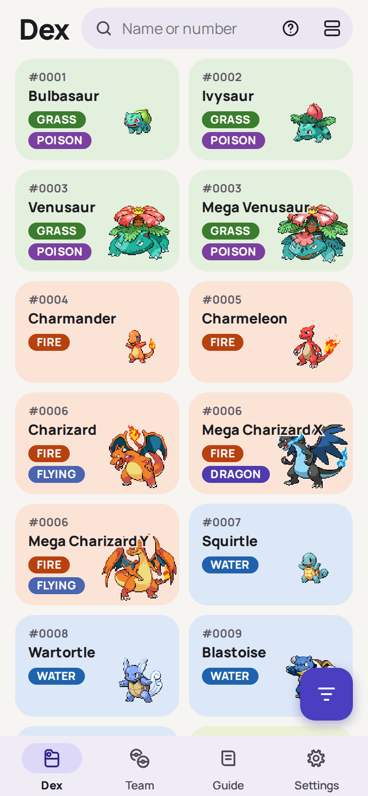
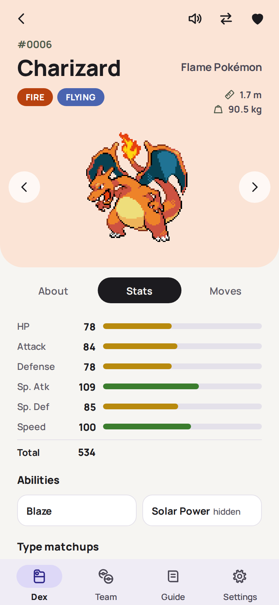
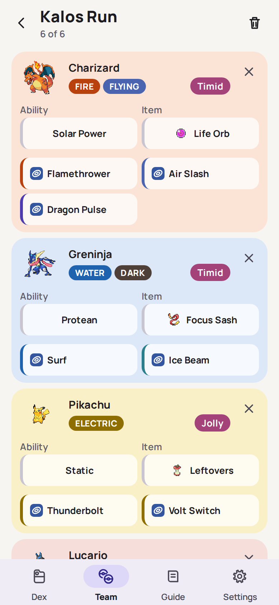
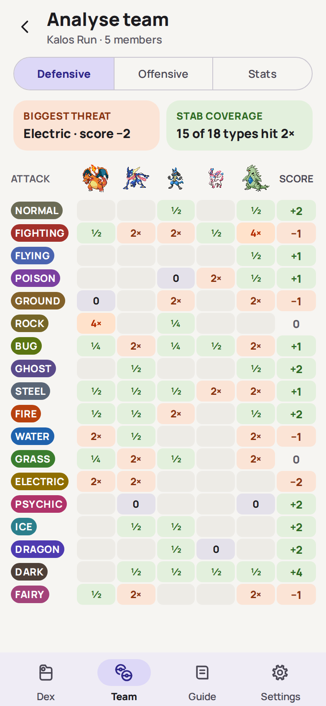
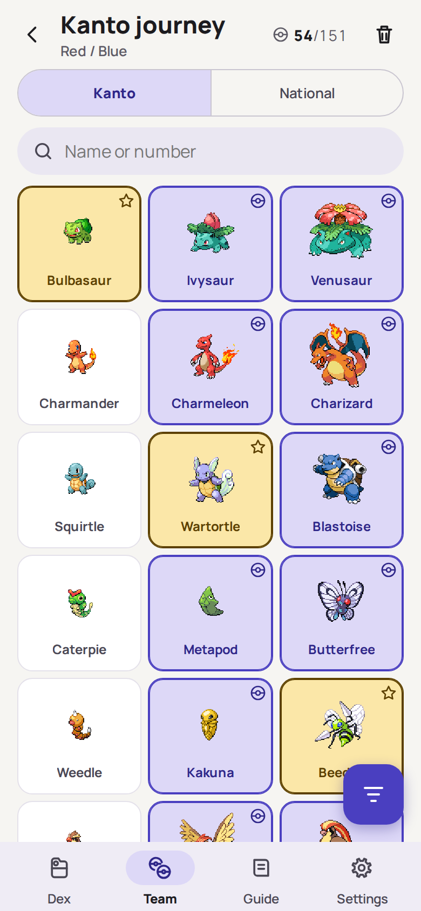
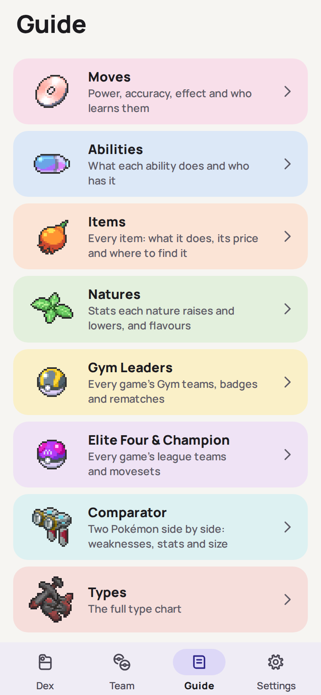
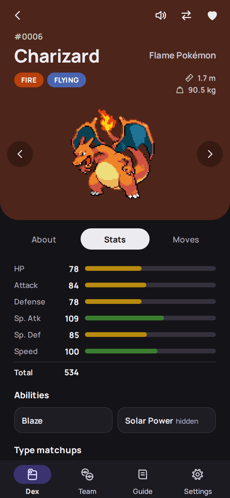
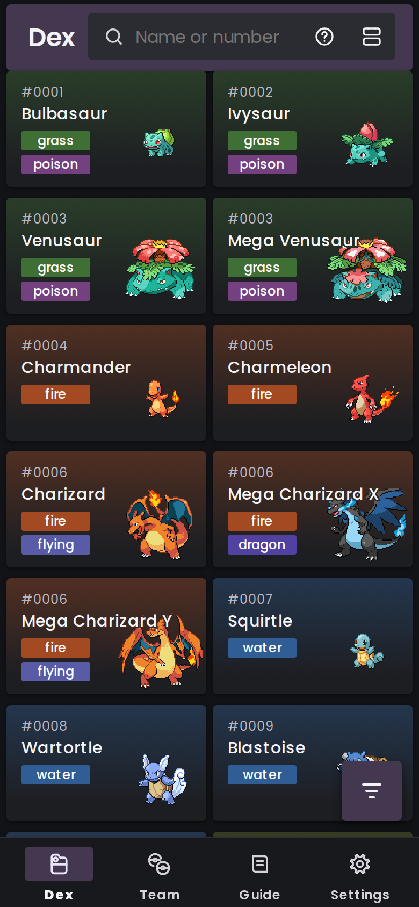

# TedDex

An offline-first Pokédex and team builder you can install on mobile. It's a static web app with no server: 1,025 species, their moves, evolutions and locations all work in airplane mode after the first visit.

**Live: <https://teddex.vercel.app/>**

| Dex                                                              | Species page                                                    | Team                                                                     | Team analysis                                                                    |
| ---------------------------------------------------------------- | --------------------------------------------------------------- | ------------------------------------------------------------------------ | -------------------------------------------------------------------------------- |
|  |  |  |  |

| Pokédex tracker                                                               | Guide                                                    | Dark theme                                                  | Design B                                                            |
| ----------------------------------------------------------------------------- | -------------------------------------------------------- | ----------------------------------------------------------- | ------------------------------------------------------------------- |
|  |  |  |  |

## Features

- **Dex:** a virtualised grid or list, with fuzzy search, `&`, `|` and `!` operators, and filters for generation, type and category. Megas, regional and other forms can appear as their own rows.
- **Species pages:** stats, type matchups, abilities, evolution lines, per-game learnsets and locations, cries, and shiny art. Forms have their own types and stats, and regional forms their own moves and evolution lines.
- **Teams:** ability, nature, held item, moves, nickname and shiny for each member, with defensive, offensive and stat analysis.
- **Pokédex tracker:** seen, caught and shiny for National, regional and custom dexes.
- **Guide:** moves, abilities, items and where to find them, natures, the type chart, a comparator, and Gym Leader and Elite Four teams for 19 games.
- **Backup:** export everything to JSON, and import it with strict validation.
- **Designs:** a Material 3 design with light and dark themes, and an alternative dark design, all from one set of tokens.

## Stack

TypeScript, React 19, React Router 7 and Vite 8, with Dexie (IndexedDB), Fuse.js, TanStack Virtual and vite-plugin-pwa (Workbox). The styling is plain CSS in cascade layers, without a UI kit. Oxlint, Oxfmt and Node's test runner handle quality checks.

## Engineering highlights

- **Build-time data:** scripts turn PokeAPI's CSV dump and Bulbapedia's wikitext into static JSON, and fail on anything they can't map rather than guess.
- **Offline by design:** per-id data ships in 64-id chunks, which keeps the service worker's precache to about 180 files. Thousands of sprites go to a separate versioned cache in the background.
- **Testable logic:** filtering, search parsing, coverage maths and evolution lines are pure functions, covered by more than 500 tests that also validate the built data.
- **Design rules in tests:** contrast ratios, the type scale, motion durations and CSS structure are all checked automatically.

## Run it

Requires Node 22.12 or later, and npm.

```bash
npm install
npm run dev          # http://localhost:5173
```

| Command                                | What it does                                 |
| -------------------------------------- | -------------------------------------------- |
| `npm run build`                        | Typecheck and production build, into `dist/` |
| `npm run preview`                      | Serve the production build                   |
| `npm test`                             | All tests                                    |
| `npm run test:logic`                   | Pure logic tests only, in about a second     |
| `npm run test:coverage`                | Tests with a coverage report on `src/data/`  |
| `npm run lint`, `npm run format:check` | Oxlint and Oxfmt                             |

The generated data and media are committed, so none of this needs the data builds. To try it on a phone, deploy it: the service worker needs a production build over HTTPS.

## Documentation

- [Architecture](docs/ARCHITECTURE.md): routes, state, caching and migrations
- [Data pipeline](docs/DATA_PIPELINE.md): the build scripts and what they produce
- [Deployment](docs/DEPLOYMENT.md): hosting and release checks
- [Tests](tests/README.md): what each test folder covers

## Licence and credits

The source code is under the [MIT licence](LICENSE). That doesn't cover the data and media in `public/`, which keep their own terms: see [third-party notices](THIRD_PARTY_NOTICES.md).

TedDex is an unofficial, free, non-commercial fan project, not affiliated with Nintendo, Game Freak or The Pokémon Company, who own Pokémon names, images and sounds. Its feature set is modelled on the Android app Goldex, with its own name, icon and palette. Data comes from [PokeAPI](https://pokeapi.co) and [Bulbapedia](https://bulbapedia.bulbagarden.net/) (CC BY-NC-SA 2.5), and trainer sprites and Pokédex art from [Bulbagarden Archives](https://archives.bulbagarden.net/).
