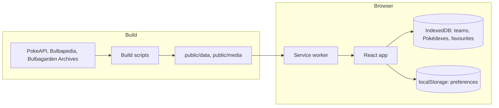

# Architecture

A static, offline-first single-page app. There is no server: build scripts turn open data into files that ship with the
app, and the browser keeps everything else.



## Stack and runtime

- **App:** TypeScript, React 19, React Router 7 (data router), Vite 8.
- **Storage and lists:** Dexie for IndexedDB, Fuse.js for fuzzy search, TanStack Virtual for the grid.
- **Offline:** vite-plugin-pwa (Workbox).
- **Styling:** plain CSS in cascade layers. Hand-written CSS matched the designs more closely than a UI kit, and keeps the
  bundle small.
- **Tooling:** Oxlint, Oxfmt, Node's test runner through `tsx`.
- **Target:** any current browser; iOS Safari, installed to the home screen, is the main one.
- **Entry points:** `index.html` → `src/main.tsx`.

## Boundaries

| Folder                   | Holds                                                              |
| ------------------------ | ------------------------------------------------------------------ |
| `scripts/`               | Data and media builds, see [DATA_PIPELINE.md](DATA_PIPELINE.md)    |
| `public/data/`, `media/` | Their committed output                                             |
| `src/data/`              | Data access and pure logic, the only code most tests need          |
| `src/screens/<feature>/` | Routes: dex, detail, teams, pokedex, guide (with league), settings |
| `src/components/<Name>/` | Shared components, one per folder, with their own CSS              |
| `src/hooks/`             | Shared hooks                                                       |
| `src/styles/`            | Layer order, tokens, shared rules, motion                          |
| `tests/`                 | See [tests/README.md](../tests/README.md)                          |

The app reads only its own static files at runtime. The one external host is Google Fonts, for Manrope and Poppins; the
stylesheet loads without blocking the first paint, and the system font stands in until it arrives.

## Routing

`createBrowserRouter` in `src/main.tsx`. A `Shell` layout renders the bottom nav on every screen and restores scroll.

| Path                                              | Screen                                                                             |
| ------------------------------------------------- | ---------------------------------------------------------------------------------- |
| `/`                                               | `DexScreen`: grid or list, search, filters; pick mode with `?pick=` or `?compare=` |
| `/pokemon/:id`                                    | `DetailScreen`: About, Stats and Moves; a form with `?form=`                       |
| `/teams`                                          | `TeamsScreen`: saved teams                                                         |
| `/teams/:id`                                      | `TeamEditor`: a team's member cards                                                |
| `/teams/:id/member/:index`                        | `MemberEditor`: form shown, ability, nature, item, moves, nickname                 |
| `/teams/:id/coverage`                             | `CoverageScreen`: Defensive, Offensive and Stats                                   |
| `/teams/pokedex`                                  | `PokedexList`: Pokédex trackers                                                    |
| `/teams/pokedex/new`, `new/custom`                | `NewPokedex`, `NewCustomPokedex`: choose a game, or choose species                 |
| `/teams/pokedex/:id`, `:id/edit`                  | `PokedexScreen`, `EditPokedexSpecies`: track a dex, edit a custom list             |
| `/reference`                                      | `ReferenceScreen`: the Guide menu                                                  |
| `/reference/compare`                              | `CompareScreen`: two Pokémon side by side                                          |
| `/reference/league`, `/reference/gyms`            | `LeagueList`: games with teams                                                     |
| `/reference/league\|gyms/:game`                   | `LeagueGameScreen`: a game's trainers                                              |
| `/reference/league\|gyms/:game/:trainer`          | `TrainerScreen`: a team, with rematch and choice pickers                           |
| `/reference/league\|gyms/:game/:trainer/coverage` | `TrainerCoverageScreen`: the same coverage view for the team shown                 |
| `/reference/egg-groups/:group`                    | `EggGroupEntry`: the species in an egg group                                       |
| `/reference/:kind`, `/reference/:kind/:id`        | `ReferenceList`, `ReferenceEntry`: searchable lists and their pages                |
| `/more`                                           | `SettingsScreen`: design, theme, images, Dex forms, backup, credits                |

URLs say `/reference` and `/more` where the screens now read Guide and Settings, so old links keep working. Sheets that
must close on Back are in the URL too: `?peek=` for the quick view and `?game-sheet=1` for the game sheet.

The host must serve `index.html` for unknown paths; offline, the service worker does this through `navigateFallback`.

## State

| Store          | Holds                                                                                                                                                    |
| -------------- | -------------------------------------------------------------------------------------------------------------------------------------------------------- |
| Static JSON    | Everything about the games, read through `src/data/api.ts`, which memoises the promises. Shapes are in `src/data/types.ts`                               |
| IndexedDB      | Dexie database `material-dex`, schema version 13, in `src/data/db.ts`: `teams`, `pokedexes`, `favourites`                                                |
| localStorage   | Device preferences: `theme`, `design`, `sprite-style`, `game`, `god-mode`, `dex-forms`, `dex-view`                                                       |
| sessionStorage | The current Dex list, so detail prev/next follows it (`dex-filters`, `dex-order`), the last detail tab (`detail-tab`), the last compare (`compare-last`) |
| URL            | Search queries, list filters, forms, rematch choices and open sheets                                                                                     |

The database keeps its early name, as does the backup's `app` id, so saved teams and old backups keep loading.

All user data stays on the device; there are no accounts. The app asks for persistent storage so iOS is less likely to
evict it, and Settings exports and imports it as JSON. An import only adds, and never replaces.

### Migrations

Each Dexie schema version keeps saved data readable. Some add a table or an optional field; others reshape data: version 2 dropped member fields that no longer fit, version 7 dropped a team's game, version 11 moved god mode from teams to a device
preference, version 12 cut names to their new limit.

### Keeping logic testable

Filters, search, coverage, evolution lines, backups and similar logic are pure functions in `src/data/`, so they run under
Node with no browser. The search operators have a small parser (`src/data/query.ts`) shared by the Dex, Moves and Items.

## Caching and offline

Configured in `vite.config.ts`, with `registerType: 'autoUpdate'`.

| What                   | How                                                                                 | Why                                                    |
| ---------------------- | ----------------------------------------------------------------------------------- | ------------------------------------------------------ |
| App shell and all data | Precached, about 180 entries                                                        | Chunking keeps the manifest small                      |
| Sprites                | Listed in `data/sprites.json` and fetched into `sprites-<hash>` (`spriteCache.ts`)  | Thousands of entries would bloat the precache manifest |
| Artwork and cries      | Runtime `media` cache, CacheFirst, sized from their file counts, with range support | About 50 MB, so they are cached on first view          |
| Google Fonts           | Runtime `fonts` cache, CacheFirst                                                   |                                                        |

Safari requests audio in byte ranges, and a 206 response can't be cached, so a detail page fetches its whole cry once on
open. Offline, artwork never viewed falls back to the sprite (`monImageChain`), and a cry never heard shows a toast.

## Trust boundaries

Backup import is the only untrusted input. `importBackup` (`src/data/db.ts`) checks every team, member, Pokédex and
favourite against the data (ability names for shape only), copies only known fields, and writes nothing if anything fails; a toast names the problem.

## Styles

Plain CSS in cascade layers, declared once in `src/styles/index.css`:
`tokens, base, primitives, components, screens, design-b, overrides`. A later layer wins whatever the selectors'
specificity. `src/styles/tokens.css` is the only file in `src/` with literal colours. `tests/design/css-structure.test.ts` enforces
where rules live, and `scripts/check-design-drift.sh` flags colours outside the tokens file named in
`scripts/design-drift.conf`.

## Configuration

No environment variables. For hosting, see [DEPLOYMENT.md](DEPLOYMENT.md).

## Testing

`npm test` runs `tests/**/*.test.ts` with Node's test runner, typechecked by `tsconfig.test.json`. There are no component
or browser tests and no CI; screens and gestures are checked by hand at 390×844. The folders are explained in
[tests/README.md](../tests/README.md).

The gate before a change lands:

```bash
npx tsc -b && npm run lint && npm run format:check && npm test && npm run build
```
