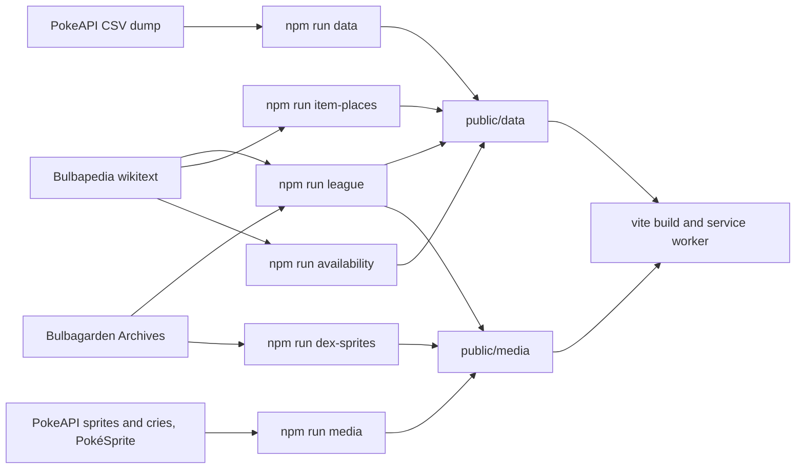

# Data pipeline

Nothing is fetched from PokeAPI or Bulbapedia at runtime. Build scripts turn their content into static files under
`public/data/` and `public/media/`, and those files are committed, so `npm run build` needs no network.

## Commands

Run `npm run data` first; the others read its output.

| Command                | Needs             | Writes                                                                                                |
| ---------------------- | ----------------- | ----------------------------------------------------------------------------------------------------- |
| `npm run data`         | network           | `public/data/`: species, moves, learnsets, evolution, reference lists, encounters, regional Pokédexes |
| `npm run media`        | network, `ffmpeg` | `public/media/sprites`, `artwork`, `cries`, `items`, `guide`                                          |
| `npm run league`       | `curl`, `ffmpeg`  | `public/data/league/`, `public/data/gyms/`, `public/media/trainers/`                                  |
| `npm run item-places`  | `curl`            | `public/data/reference/places/`: where to find each item                                              |
| `npm run availability` | `curl`            | Text rows in `public/data/locations/`, and the games PokeAPI has no encounters for in `games.json`    |
| `npm run dex-sprites`  | `curl`, `ffmpeg`  | `public/media/dexes/`: each game's Pokédex art                                                        |

Add `-- --fresh` to any of them to download again instead of reading `.cache/` (git-ignored).
`npm run media -- --redo=artwork,artwork/shiny,cries` re-converts those kinds from the download cache.

`npm run data` rewrites the folder, so run the Bulbapedia builds again after it. `tests/pipeline/availability.test.ts`
fails until `npm run availability` has restored the text rows. After any rebuild, run `npm test`.

## Output

| File                                                 | Contents                                                                           |
| ---------------------------------------------------- | ---------------------------------------------------------------------------------- |
| `index.json`                                         | One grid row per species (1025), default forms, listing their other forms          |
| `types.json`                                         | The 18 types and the damage matrix                                                 |
| `species/c<n>.json`                                  | Detail: stats, abilities, forms, training and breeding facts                       |
| `learnsets/c<n>.json`, `moves.json`, `versions.json` | Moves per main-series version group, by learn method                               |
| `evolution/c<n>.json`                                | Chain members, with the form steps that regional lines follow                      |
| `locations/c<n>.json`, `games.json`                  | Encounters per game, as tuples into a string table                                 |
| `items.json`, `abilities.json`, `egg-groups.json`    | The light lists team screens and egg group pages need                              |
| `reference/`                                         | Guide pages: `moves/c<n>.json`, `abilities.json`, `items.json`, `places/c<n>.json` |
| `pokedexes.json`                                     | Every regional dex once, and each version group's dexes in order                   |
| `league/`, `gyms/`                                   | An index and one file per game (19 games)                                          |
| `meta.json`                                          | Data version, build time, species count                                            |

Shapes live in `src/data/types.ts`, and must match the build scripts.

### Chunks

Per-id data ships in chunks of 64: `c<n>.json` holds ids `n×64` to `n×64+63` (`src/data/chunks.ts`). This keeps the
precache at about 180 files instead of thousands, and lets a chunk share its strings: learnsets keep each distinct list
once per species, and locations share one string table per chunk. The loaders in `src/data/api.ts` unpack them.

### Forms

Regional, Mega, Primal, Gigantamax and other battle forms carry their own types, stats, abilities and size in
`species/`. Totems and forms identical in battle are left out. All but Megas, Primals and Gigantamax also have their own
learnsets, evolution steps and encounters, falling back to the species where they don't differ (`hasOwnFormData`).

## PokeAPI

`scripts/build-data.ts` downloads the CSV dump, joins it and writes the files above. `scripts/encounters.ts` merges
encounter slots into one row per area and method. `scripts/megaStones.ts` matches each Mega to its stone, and the build
fails on a Mega it can't match, or on an item category `src/data/itemCategories.ts` doesn't know.

PokeAPI's encounter data stops at Sword and Shield, which is why the availability build exists.

## Bulbapedia

PokeAPI has no trainers, and no game-by-game acquisition text. Bulbapedia challenges Node's fetch, so its pages come
through `curl`, one per second (`fetchPage` in `scripts/bulbapedia.ts`), and are cached in `.cache/bulbapedia/`.

The parsers fail loudly instead of guessing, so a template or name they don't know stops the build:

- **League and Gym teams** (`scripts/league.ts`, `scripts/build-league.ts`): `scripts/league-manifest.json` and
  `scripts/gym-manifest.json` are hand-written and pick each trainer's battle and rematches on the wiki. Names are mapped
  to our ids. Post-game rematches only, never battle facilities.
- **Item places** (`scripts/itemPlaces.ts`): each item's core-series acquisition table, merged with PokeAPI's wild holders.
- **Availability** (`scripts/availability.ts`): each species' game locations table, as text rows ("Evolve from
  Charmeleon", "Trade, Event"). PokeAPI's rows win per game and form. Side games and Legends: Z-A are left out, and DLC
  folds into its base games. The first run takes about 17 minutes.

## Media

| Folder                       | Format                                           | Offline                  |
| ---------------------------- | ------------------------------------------------ | ------------------------ |
| `sprites/`, `sprites/shiny/` | WebP, lossless                                   | Warmed in the background |
| `items/`                     | WebP, pixel art doubled, renders shrunk to 64 px | Warmed in the background |
| `guide/`                     | WebP, the Guide menu's pixel art                 | Warmed in the background |
| `trainers/`                  | WebP, first frame of each party sprite           | Warmed in the background |
| `dexes/`                     | WebP, 160 px                                     | Warmed in the background |
| `artwork/`, `artwork/shiny/` | WebP, 368 px, q65                                | Cached on first view     |
| `cries/`                     | AAC, 40 kbps mono (iOS Safari plays it)          | Cached on first view     |

Forms add sprites and artwork under their own Pokémon id; cries stay per species. Forms PokeAPI has no shiny file for are
listed in `tests/data/sprite-cache.test.ts` and fall back through `monImageChain` (`src/data/api.ts`).

## Licences

Each source keeps its own terms: see [`THIRD_PARTY_NOTICES.md`](../THIRD_PARTY_NOTICES.md).
