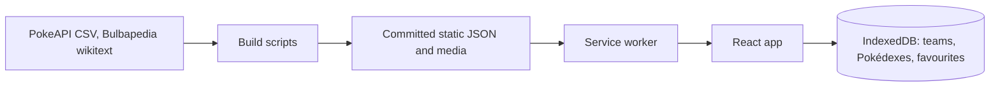

# TedDex: an offline-first Pokédex that fits in a phone's cache

Status: describes commit `a41c1218`. The live site and the source repository are public.

## Problem and audience

Goldex is the Android app whose feature set TedDex is modelled on: a Material-style Pokédex and team builder. It has no iOS version, and on iOS the usual alternative is a web wiki that needs a connection. TedDex is for Pokémon players who want a fast reference on their phone, often offline and one-handed, for example while playing on a console. Its first user is me.

The technical problem is size. A complete dex has 1,025 species, hundreds of forms, per-game learnsets and encounters, and thousands of images, and all of it has to work in airplane mode from a static host.

## Constraints, scope and non-goals

- **No backend.** No server, accounts or sync. User data stays on the device ([ARCHITECTURE.md](../docs/ARCHITECTURE.md)).
- **No runtime calls to the data sources.** PokeAPI and Bulbapedia are read at build time only, and the output is committed, so `npm run build` needs no network ([DATA_PIPELINE.md](../docs/DATA_PIPELINE.md)).
- **iOS Safari, installed to the home screen, is the main target.** It decides the audio format and how cries are cached.
- **Free static hosting.** Vercel's free tier ([DEPLOYMENT.md](../docs/DEPLOYMENT.md)).
- **Non-commercial, with its own identity.** Own name, icon and palette, and no Goldex assets. Pokémon names, images and sounds belong to their owners, and the data and media keep their own terms ([THIRD_PARTY_NOTICES.md](../THIRD_PARTY_NOTICES.md)).
- **Non-goals:** CI, accounts, monetisation, and battle facility teams.

## Solution, architecture and data flow

TypeScript, React 19 and React Router 7 on Vite, with Dexie for IndexedDB, Fuse.js for search, TanStack Virtual for the grid and vite-plugin-pwa (Workbox) for offline.

Three parts carry most of the design:

1. **A build pipeline with strict parsers.** `scripts/` joins PokeAPI's CSV dump with Bulbapedia wikitext into static JSON. Anything a parser can't map stops the build (`scripts/league.ts`, `scripts/itemPlaces.ts`, `scripts/availability.ts`).
2. **Three offline tiers, chosen by size.** The app shell and all data are precached. Sprites are warmed in the background into a content-versioned cache (`src/data/spriteCache.ts`). Artwork and cries are cached on first view (`vite.config.ts`).
3. **Pure logic.** Filters, the search query parser, coverage maths, evolution lines and backup parsing are plain functions in `src/data/`, so they run under Node without a browser.

## My contribution and collaboration

I defined the product and its scope, made or approved the decisions below, and judged the results by using the app. That included:

- Setting the requirements, and growing the scope from a first version through several rounds of bug and change lists, some of which reversed earlier decisions.
- Choosing size targets and rejecting encoding settings that missed them.
- Deploying it, and running the checks only a real device can answer: iOS cry playback, airplane mode and VoiceOver.

This section claims those decisions and checks. It is not a claim about what share of the code I typed.

The work depends on others': PokeAPI and Bulbapedia for the data, Bulbagarden Archives and PokéSprite for images, and the libraries named above. Credits are on the Settings screen and in [THIRD_PARTY_NOTICES.md](../THIRD_PARTY_NOTICES.md).

## Important decisions, alternatives and tradeoffs

**Chunks instead of one file per id.** One JSON file per id, plus every sprite in the manifest, grew feature by feature to 10,224 precache entries and a 793 KB `sw.js`, which every client must download and parse. Per-id data now ships in chunks of 64 ids (`src/data/chunks.ts`), with strings shared inside a chunk. The cost is a decode step in the loaders (`src/data/api.ts`), and when the format changed, an installed app left open kept asking for the old files until it relaunched.

**Warming sprites instead of precaching them.** Nearly 5,000 small files don't belong in a manifest. A build step lists them in `data/sprites.json`, and the app fetches whichever ones the cache lacks, six at a time. An interrupted run resumes on the next launch. The cost is that a fresh install isn't fully offline at once: until the warm-up ends, a sprite not yet fetched can't load offline.

**Artwork and cries on first view.** At about 47 MB these would dominate an install, so they aren't downloaded up front. Offline, artwork never viewed falls back to the sprite (`monImageChain`) and an unheard cry shows a toast. So "works offline" means all data and sprites, but not all artwork and sound.

**AAC cries, and caching them whole.** Cries started as hot-linked OGG, which isn't reliable on iOS and wasn't offline on first view, so media moved in-house as WebP and M4A (`56bc3169`). Safari requests audio in byte ranges, and a 206 response can't be cached, so a detail page fetches the whole cry once on open and the cache has range support (`vite.config.ts`).

**Measured encoding targets.** The first media settings (artwork q75, cries 48 kbps) saved 20.5% and 22.4%, short of a 25% target, so I went to q65 and 40 kbps. The compromise is resolution as well as quality: 368 px artwork sits below the hero's 552 device pixels on a 3× screen, and I judged it sharp enough on a phone.

**Failing the build instead of guessing.** Bulbapedia is written for people and its templates vary. Skipping what a parser doesn't recognise would quietly ship wrong teams, so an unknown template or name stops the build. The cost is that a wiki change can break a rebuild, and that the trainer battles are picked in curated manifests (`scripts/league-manifest.json`). Output is committed, so an ordinary build isn't exposed to this.

**Plain CSS instead of a UI kit.** A kit was the original plan. Plain CSS in cascade layers matched the designs more closely, and the app has two designs from one token file. The cost is owning every component, and the bundle saving was never compared against a kit build, so I make no claim about its size. All JS is still one chunk with no route splitting, which is the next place I'd look.

**Backup import as the one trust boundary.** With no server, an imported JSON file is the only untrusted input. `importBackup` (`src/data/db.ts`) checks entries against the data, copies only known fields and writes in one transaction after all checks pass. It only adds, so a bad or duplicate import can't overwrite anything, at the cost of never replacing data either.

## Quality, security, accessibility and operational evidence

- **Automated tests:** 521 tests in four folders: pure logic, build parsers, built data, and design rules ([tests/README.md](../tests/README.md)). The data tests check the shipped output, not only fixtures.
- **Design rules as tests:** white text on type and game colours at 4.5:1 or better, the type scale, motion durations and properties, and where CSS rules live (`tests/design/`). These read source and tokens. They don't render anything.
- **Not automated:** the UI. No test renders a component or drives a browser, and there is no CI. Screens and gestures are checked by hand at 390×844, and the gate runs locally.
- **Accessibility:** 44 px touch targets and `prefers-reduced-motion` handling are project rules; keyboard and VoiceOver reach on the main flows were checked by hand at an early milestone and not repeated for later features. No automated audit has been run.
- **Security:** no accounts, secrets or server, and no environment variables. `npm audit` reports nothing for production dependencies; 9 moderate and 3 low advisories remain in development dependencies, not triaged. The site sets no custom security headers (`vercel.json`), and Google Fonts is its one external host. No formal security review or secret scan has been done.
- **Operations:** a static deploy with a post-release check list ([DEPLOYMENT.md](../docs/DEPLOYMENT.md)). There is no monitoring or analytics, so I have no data on real use.

## Results and measurements

| Claim                                                                                                                                | Public source or sanitized evidence summary                                                           | Measurement method, environment and workload                                                                                              | Limitations                                                                                                        |
| ------------------------------------------------------------------------------------------------------------------------------------ | ----------------------------------------------------------------------------------------------------- | ----------------------------------------------------------------------------------------------------------------------------------------- | ------------------------------------------------------------------------------------------------------------------ |
| Chunking data and moving sprites out of the manifest cut precache entries from 10,224 to 178 (−98%) and `sw.js` from 793 KB to 15 KB | `vite build` of `316f34f5` (before) and merge `ae60325b` (after)                                      | Counted `url:` entries in `dist/sw.js` and its bytes, same local dependencies for both                                                    | Both changes landed together, so the drop isn't split between them. Build output only, not a load time on a device |
| Precached bytes fell from 13.99 MB to 8.48 MB (−39%)                                                                                 | Same two builds                                                                                       | Sum of the files listed in `sw.js`                                                                                                        | Uncompressed. The sprites still download, just outside the precache                                                |
| Data fell from 6,560 files, 2.81 MB gzip, to 160 files, 1.31 MB gzip (−53%)                                                          | `public/data/` at the same two commits                                                                | Each file gzipped separately at default level, then summed; not what Vercel's compression would send                                      | Raw size fell less: 9.16 to 7.67 MB. Equality of content was checked with a one-off script, not kept               |
| Current precache: 181 entries, 9.63 MB, `sw.js` 15.6 KB; JS 197 KB and CSS 16 KB gzip                                                | `npm run build` at `a41c1218`                                                                         | As above                                                                                                                                  | Later features added entries since the chunking                                                                    |
| Shrinking media cut artwork 26.11 to 19.33 MB (−26%) and cries 11.11 to 7.37 MB (−34%)                                               | `git ls-tree -l` at `65e332fb` and `43f1c6d4`                                                         | Sum of blob sizes for 1,299 artwork and 1,025 cry files                                                                                   | Quality judged by eye. Shiny artwork was added later, so `artwork/` is now 39.45 MB                                |
| Main screens render with no server                                                                                                   | Smoke test of the production build at `a41c1218` (sanitized summary; the script isn't committed)      | Desktop Chromium at 390×844. Waited for 4,966/4,966 sprites, stopped the local server, then loaded 11 routes: 11 passed, no broken images | Not iOS, not a real network, and fonts weren't blocked. Text and images only; no gestures or writes                |
| Sprite warm-up finished in about 42 s                                                                                                | Same run                                                                                              | Loopback server, 6 parallel fetches, no network latency                                                                                   | Lower bound. Not timed on a phone or mobile network                                                                |
| Checks pass at `a41c1218`                                                                                                            | `npx tsc -b`, `npm run lint`, `npm run format:check`, `npm test`, `npm run build`                     | Run locally: 521 tests, 0 failed, 0 skipped, on Linux                                                                                     | Lint reports warnings, no errors                                                                                   |
| Logic coverage: 88.7% lines, 97.8% branches, 79.8% functions                                                                         | `npm run test:coverage`                                                                               | Node's built-in coverage on `src/data/`, all modules loaded                                                                               | No screen or component code is measured                                                                            |
| Cries play in the installed iOS app, online and in airplane mode                                                                     | Sanitized summary of a manual check on my phone                                                       | One device, by hand, after the media change                                                                                               | Not repeated at this commit. No device matrix                                                                      |
| The live site serves this revision's assets                                                                                          | `https://teddex.vercel.app/` returned the same hashed JS and CSS names as a local build of `a41c1218` | One `curl` of the page, compared with `dist/index.html`                                                                                   | Shows the deployed files match, not how they behave                                                                |

Unknown, and not claimed: number of users, real-world load time, storage eviction rates on iOS, and any comparison with Goldex or wiki performance. `navigator.storage.persist()` is requested, but whether it protects the data on a given device is unmeasured.

Known gaps at this commit: PokeAPI's encounter data stops at Sword and Shield, so later games show Bulbapedia's text instead of rates, and Legends: Z-A is left out of location data. The Dex card name outline uses `paint-order`, which hasn't been confirmed on WebKit.

## Lessons and what I would change

- **Set a budget early.** The precache reached 10,224 entries one reasonable feature at a time. A size test from the start would have flagged it much sooner than an audit did.
- **Decide what a target measures.** The size target had to be re-based once I saw that stored bytes and bytes downloaded at install behave differently.
- **Look on a real phone at each milestone.** Later change lists reversed some earlier decisions. Earlier looks on a device might have made those cheaper, though I didn't measure that.
- **Add browser tests for the core flows.** The logic is well covered, but nothing automated would catch a broken screen, and the offline behaviour matters most and is checked least. I'd also add CI, and keep the offline smoke test in the repository.

## Verified repository, demo, documentation and release links

- **Demo:** <https://teddex.vercel.app/> (responded at this commit)
- **Repository:** <https://github.com/tiago-espadinha/TedDex>
- **Documentation:** [README](../README.md), [architecture](../docs/ARCHITECTURE.md), [data pipeline](../docs/DATA_PIPELINE.md), [deployment](../docs/DEPLOYMENT.md), [tests](../tests/README.md)
- **Releases:** none tagged
